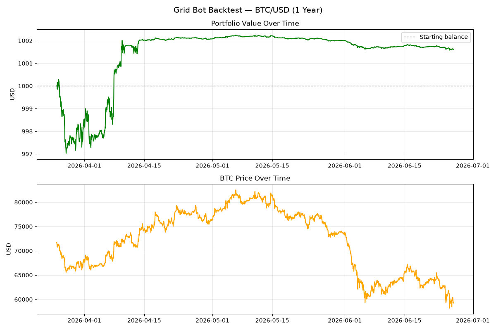

# Crypto Grid Bot

A multi-coin grid trading bot for Coinbase, built in Python. It trades BTC, ETH
and SOL at the same time using a grid strategy with a 200-period trend filter,
built-in risk limits, a live Flask dashboard, and backtesting tools. It runs in
paper-trading mode by default, so no real money is used.



## Features

- **Grid strategy** across BTC, ETH and SOL, with grid spacing tuned per coin
- **Trend filter** that blocks buys while price is below the 200-period moving average
- **Risk manager** with a daily loss limit and a cap on open orders
- **Paper and live modes** (paper is the default)
- **Live dashboard** in Flask for monitoring prices and trades
- **Backtesting and parameter optimization** against historical Coinbase data
- **Trade log** saved to `trades.csv` for analysis

## Tech stack

Python 3 · pandas · Flask · matplotlib · Coinbase public market data and Advanced Trade API

## Status

Working and tested in paper-trading mode. Not yet run with real money.

## File structure

```
crypto_bot/
  bot.py          - Run this to start the bot
  config.py       - Settings + loads API credentials from .env
  data.py         - Fetches prices + candles from Coinbase
  strategy.py     - Grid strategy logic
  risk.py         - Stop-loss, daily limits, position sizing
  executor.py     - Places paper or live orders
  logger.py       - Records trades to trades.csv
  backtest.py     - Backtest the strategy against historical data
  optimize.py     - Sweep grid settings to find good parameters per coin
  dashboard.py    - Live dashboard for the bot
  requirements.txt
  .env.example    - Template for your API credentials (copy to .env)
```

## Setup

**1. Install dependencies**
```bash
pip install -r requirements.txt
```

**2. Get Coinbase API keys**
- Go to Coinbase.com → Account → API Management
- Create a new key — enable "Spot & Margin Trading"
- Copy `.env.example` to `.env`, then paste your key and secret in there
  (never into `config.py` — it reads from `.env` automatically and `.env`
  is gitignored, so your credentials never get committed)
- For paper mode you don't need real keys, but you do need valid-format ones

**3. Configure the bot**
Open `config.py` and adjust:
- `paper_trade`: Keep `True` until you're confident
- `grid_spacing`: 1% is a good start for BTC
- `order_size_usd`: Start small — $10–$20 per grid level
- `daily_loss_limit`: Set this to an amount you're comfortable losing in a day

**4. Run**
```bash
python bot.py          # start the bot
python dashboard.py    # open http://localhost:5000 for the live dashboard
python backtest.py     # test the strategy on historical data
python optimize.py     # sweep grid settings per coin
```

## How the grid strategy works

The bot sets up a "grid" of buy and sell orders at fixed % intervals around the current price:

```
$61,800 ← SELL level 3
$61,200 ← SELL level 2
$60,600 ← SELL level 1
─────── current price $60,000
$59,400 ← BUY level 1
$58,800 ← BUY level 2
$58,200 ← BUY level 3
```

When price drops to a BUY level → bot buys.
When price rises to a SELL level → bot sells.
Profit = the 1% spread, captured repeatedly as price oscillates.

There's also a 200-period moving average trend filter — buys are blocked
while price is below the 200-period MA, to avoid grid-buying all the way
down in a strong downtrend.

**Best market conditions:** Sideways/ranging markets. Not ideal during strong trends.

## When to go live

Checklist before switching `paper_trade` to `False`:
- [ ] Run paper mode for at least 2 weeks
- [ ] Review trades.csv — are you profitable consistently?
- [ ] Understand every line of the code
- [ ] Start with the smallest possible `order_size_usd`
- [ ] Set a `daily_loss_limit` you can afford to lose

## Security

API credentials live in a local `.env` file (see `.env.example` for the
format) and are loaded by `config.py` at runtime — they are never
hardcoded in source and `.env` is excluded via `.gitignore`. If you ever
suspect a key has leaked, revoke and regenerate it immediately in
Coinbase's API settings.
